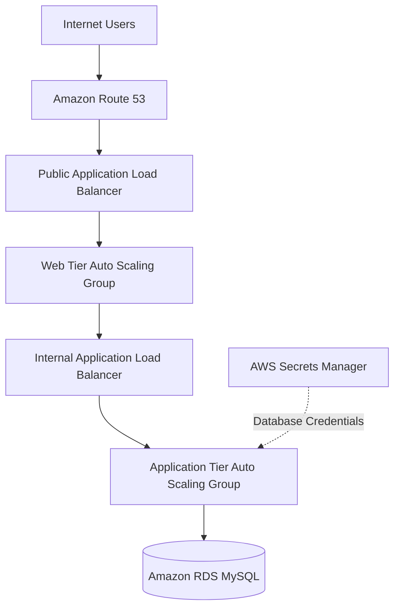

# AWS Three-Tier Infrastructure Automation

## Project Overview

This project automates the deployment of a three-tier architecture on Amazon Web Services (AWS) using Terraform.

The infrastructure separates the Web, Application, and Database tiers into different network layers to improve security, scalability, and maintainability.

**Environment:** Dev  
**Cloud Provider:** AWS  
**Infrastructure as Code:** Terraform  
**AWS Region:** Asia Pacific (Mumbai) — `ap-south-1`

## Architecture Diagram



## AWS Services Used

| AWS Service | Purpose |
|---|---|
| Amazon VPC | Isolated network infrastructure |
| Public and Private Subnets | Network separation between tiers |
| Internet Gateway | Internet connectivity for public subnets |
| NAT Gateway | Outbound internet access for private resources |
| Amazon EC2 | Hosts Web and Application tiers |
| Application Load Balancer | Distributes incoming traffic |
| EC2 Auto Scaling | Maintains and scales EC2 instances |
| AWS IAM | Manages permissions for EC2 instances |
| AWS Systems Manager | Supports instance management |
| Amazon RDS MySQL | Managed relational database |
| AWS Secrets Manager | Stores database credentials |
| Amazon Route 53 | DNS hosting and ALB alias record |
| Amazon S3 | Stores Terraform remote state |

## Key Features

- Three-tier architecture with separate Web, Application, and Database layers.
- VPC with public and private subnets across two Availability Zones.
- Internet-facing and internal Application Load Balancers.
- Auto Scaling Groups for Web and Application tiers.
- Private Amazon RDS MySQL database.
- Security Groups controlling communication between tiers.
- Database credentials managed through AWS Secrets Manager.
- Encrypted EC2 root volumes and RDS storage.
- S3 remote Terraform state with versioning and encryption.
- Terraform modules for reusable infrastructure components.

## Repository Structure

```text
aws-three-tier-infrastructure-automation/
│
├── docs/
│   ├── architecture.md
│   ├── deployment.md
│   └── security-groups.md
│
├── environments/
│   └── dev/
│       ├── main.tf
│       ├── variables.tf
│       ├── outputs.tf
│       ├── provider.tf
│       ├── versions.tf
│       ├── locals.tf
│       └── terraform.tfvars.example
│
├── modules/
│   ├── networking/
│   ├── security-groups/
│   ├── load-balancer/
│   ├── compute/
│   ├── database/
│   └── route53/
│
├── scripts/
│   ├── app/
│   │   └── user_data.sh
│   └── web/
│       └── user_data.sh
│
├── screenshots/
├── .gitignore
└── README.md
```

## Network Design

| Component | CIDR Range |
|---|---|
| VPC | 10.0.0.0/16 |
| Public Subnets | 10.0.1.0/24, 10.0.2.0/24 |
| Web Subnets | 10.0.11.0/24, 10.0.12.0/24 |
| Application Subnets | 10.0.21.0/24, 10.0.22.0/24 |
| Database Subnets | 10.0.31.0/24, 10.0.32.0/24 |

## Security Design

- Public ALB accepts HTTP traffic from the internet.
- Web instances accept HTTP traffic only from the Public ALB.
- Internal ALB accepts traffic only from the Web tier.
- Application instances accept traffic only from the Internal ALB.
- RDS accepts MySQL connections only from the Application tier.
- SSH access is restricted to the administrator's IP address.
- Database credentials are stored in AWS Secrets Manager.
- EC2 root volumes and RDS storage are encrypted.

## Deployment

### Prerequisites

- AWS account with appropriate IAM permissions.
- AWS CLI installed and configured.
- Terraform installed.
- Existing EC2 key pair.
- A registered domain name for Route 53 configuration.
- An S3 bucket created for the Terraform remote backend.

### Configuration

1. Clone this repository.
2. Navigate to `environments/dev`.
3. Create `terraform.tfvars` using `terraform.tfvars.example`.
4. Configure your AWS values, key pair, domain, and administrator CIDR.
5. Configure the S3 backend in `versions.tf` to use your own backend bucket.

### Terraform Commands

```bash
terraform init
terraform fmt -recursive ..\..\modules .
terraform validate
terraform plan
terraform apply
```

To remove the deployed infrastructure when it is no longer needed:

```bash
terraform destroy
```

Review the deployment guide in `docs/deployment.md` for additional details.

## Documentation

- [Architecture Documentation](docs/architecture.md)
- [Deployment Guide](docs/deployment.md)
- [Security Group Rules](docs/security-groups.md)

Each Terraform module also contains its own README documenting its resources, inputs, and outputs.

## Screenshots

The `screenshots/` directory contains deployment evidence, including:

- VPC and network configuration.
- Load Balancers and healthy target groups.
- Web and Application Auto Scaling Groups.
- RDS configuration and security.
- Route 53 hosted zone.
- S3 remote backend configuration.
- Terraform plan and apply results.
- Successful application access through the Public ALB.

## Project Scope and Future Enhancements

**Current implementation: Dev environment only.**

Planned enhancements:

- Configure ACM certificates and HTTPS listener after DNS delegation.
- Implement a separate Production environment.
- Extend infrastructure automation and monitoring.

## Cost Considerations

AWS resources such as NAT Gateways, RDS instances, load balancers, and Route 53 hosted zones may incur charges.

Review AWS pricing before deployment. Destroy the infrastructure when it is no longer required, while retaining the S3 backend bucket if you need to preserve Terraform state.

## Author

Cloud and DevOps Infrastructure Automation Project